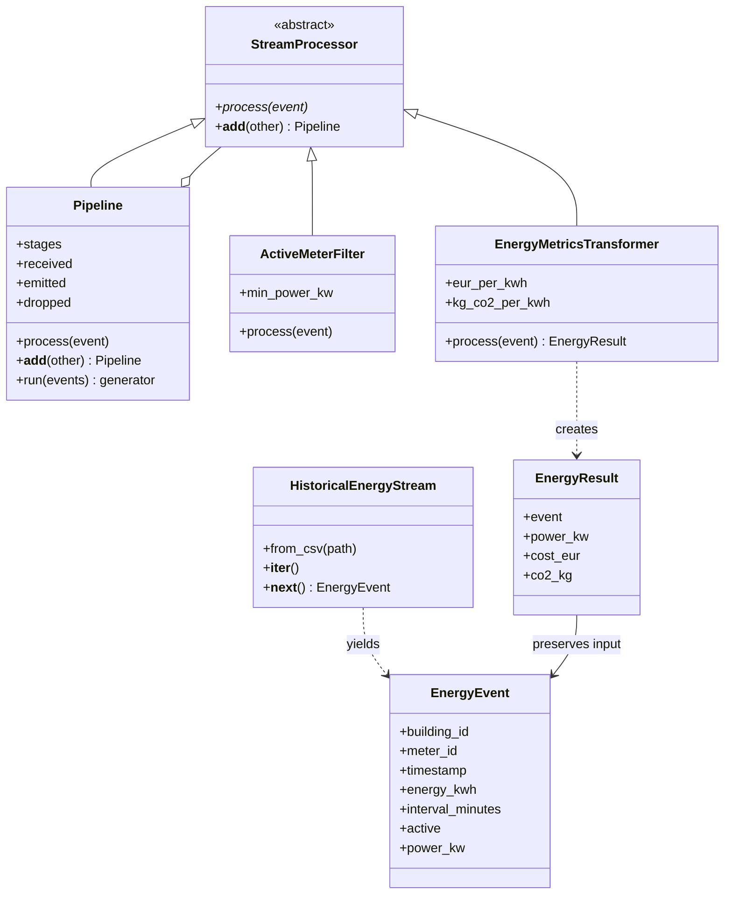
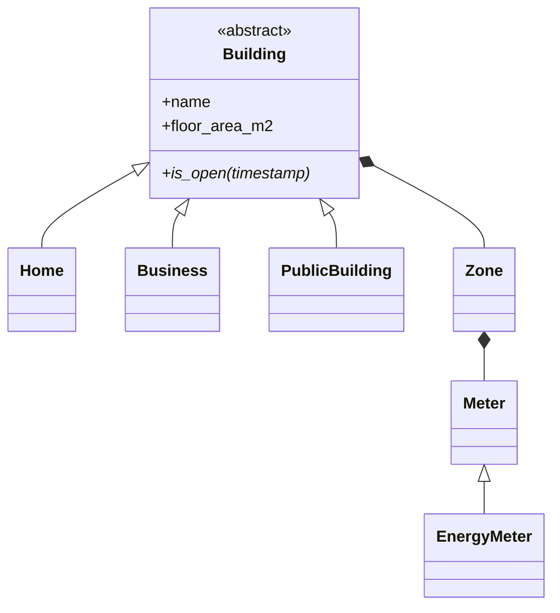

# Energy monitoring for German real estate portfolios

Academic prototype for historical electricity analysis, reporting, forecasting, and an eventual energy advisor. Streamlit is the dashboard. No physical smart meters are required.

## Identification

Team: Shreya Patil, Joywin Bennis, Ourvish Lofur. Submitting student: Joywin Bennis (confirm course registration spelling). Student ID, module, lecturer, and individual contributions: **to be supplied by the students before submission**.

## Homework 2: real-time data processing

Implemented in `backend.streaming`: abstract processor, polymorphic filter and transformer, pipeline composition with `+`, explicit iterator with `__iter__`/`__next__`, and lazy generator output. The source replays historical interval events; this is simulated real-time processing, not a live IoT connection.

```python
pipeline = ActiveMeterFilter(min_power_kw=0.1) + EnergyMetricsTransformer()
for result in pipeline.run(HistoricalEnergyStream.from_csv("data/sample/energy_events.csv")):
    print(result)
```

Average power is `energy_kwh * 60 / interval_minutes`. The filter removes inactive meters and power strictly below the threshold. The transformer calculates estimated EUR and kg CO2 using configurable demonstration factors. OPSD replay uses these same processors; all valid readings remain in storage so low-use filtering does not distort consumption reports.

## Class diagrams





## Setup and demonstration

Use Python 3.14 or later, from the repository root:

```bash
python3 -m venv .venv
source .venv/bin/activate
python -m pip install -e '.[test]'
python -m backend.streaming.demo
python -m pytest tests/test_streaming.py -q
```

The small committed fixture is synthetic and yields `received=5 emitted=3 dropped=2`. It demonstrates an inactive meter, a low-power interval, and the inclusive threshold boundary. Prices (`0.30 EUR/kWh`) and emissions (`0.38 kg/kWh`) are illustrative assumptions.

To run the existing dashboard, install its dependencies from `requirements.txt`, then `python -m streamlit run src/app.py`. For full OPSD ingestion, follow [backend data instructions](src/backend/README.md). The raw dataset is not committed; the small fixture works offline after package installation.

## Five-minute video

**Recording/link pending — the student must record and upload the demonstration before submission.** Follow the [video script](docs/VIDEO_SCRIPT.md), then replace this notice with the accessible video URL. No video has been uploaded by this implementation.

## Submission

Homework 2 branch: `HomeworkAssignment2`. Submit its verified GitHub branch URL and commit SHA, plus the video link. See the [homework plan](docs/HOMEWORK_PLAN.md) for the full roadmap. Homework 3 and 4 are cumulative follow-up branches.

## Scope and data assumptions

The wider capstone proposes portfolios, properties, buildings, electricity/gas/district heating, anomaly detection, forecasting, and an OpenAI advisor. This homework focuses on electricity and a few sample buildings. The existing OPSD import uses household-dataset residential/industrial/public columns; floor areas, tariffs, and benchmarks are assumptions. Existing seasonal forecasting is a baseline; the AI advisor is not yet integrated. PostgreSQL is a future capstone choice; Homework 3 uses the required MySQL database.
