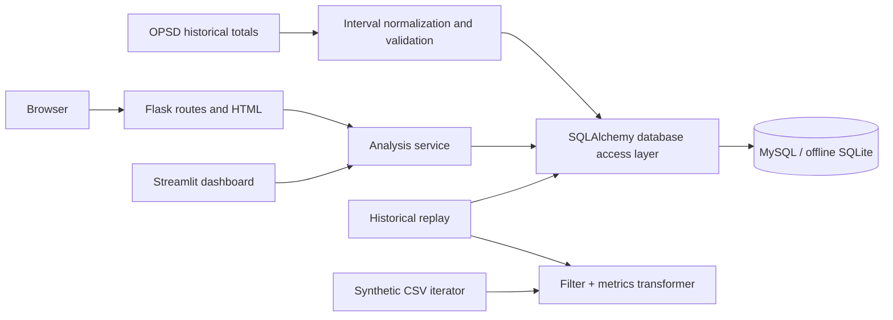
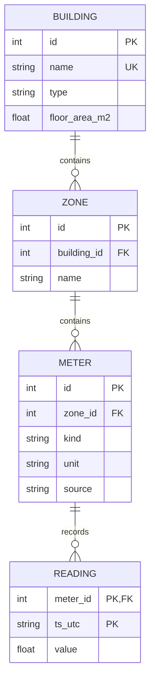

# Architecture

The streaming and building class diagrams appear directly in the root README, as required for Homework 2. The iterator yields individual interval events; the pipeline is lazy. The full OPSD normalizer currently loads selected CSV columns with Pandas, so the prototype does not claim constant-memory ingestion of the entire raw dataset.

Uniqueness: building name, `(building_id, zone name)`, `(zone_id, meter kind, source)`, and `(meter_id, UTC timestamp)`. Timestamps retain the existing canonical UTC text format (`YYYY-MM-DDTHH:MM:SSZ`), which sorts chronologically. Storage contains quarter-hour interval energy, never cumulative totals. Negative/non-finite input is rejected before persistence; foreign keys and nonnegative constraints protect writes. Repeat ingestion preserves existing readings at duplicate meter/timestamp keys.

Flask database selection uses a context-local override rather than modifying a process-wide setting, allowing independent app/test instances. Streamlit and CLI ingestion use `DATABASE_URL` from the environment or `.env`; an absent value uses the existing SQLite path. MySQL is the required Homework 3 backend. PostgreSQL remains outside this submission.

The demo has buildings, zones, and electricity meters. Portfolio/property ownership, additional energy carriers, learned anomaly detection, and live advisor integration remain capstone work.
