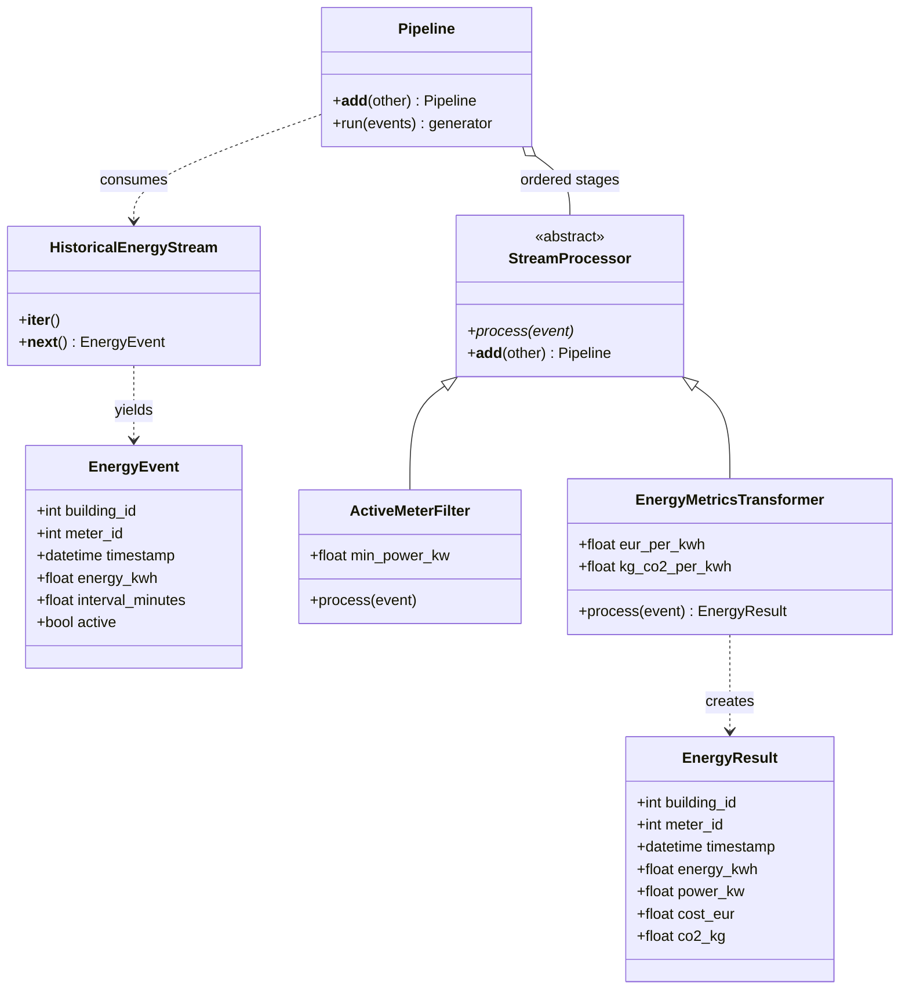
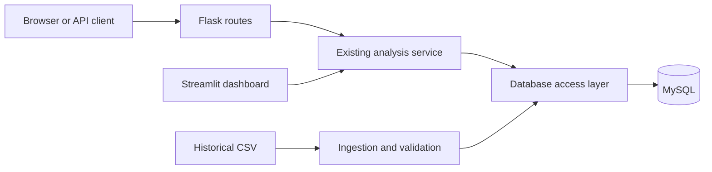

# Plan for Homework Assignments 2, 3, and 4

Prepared for the German property energy monitoring project on 6 November 2026.

Status: **planning document**. Proposed classes, routes, commands, and tests below still need implementation and verification. This document does not certify assignment completion.

## 1. Recommended approach

Use one energy project for all three assignments, delivered in stages:

1. **Homework 2:** replay historical electricity readings through an object-oriented event-processing pipeline.
2. **Homework 3:** expose the existing energy analysis through a small Flask application backed by MySQL.
3. **Homework 4:** add subsystem exceptions, error handling, and at least 15 distinct automated tests.

Keep Streamlit as the capstone dashboard. Flask adds the web/API layer required by Homework 3. Do not rebuild the whole dashboard in Flask. Include one simple Flask HTML page showing buildings fetched from MySQL, as well as JSON routes, so database output is immediately visible to the lecturer.

Implement only the **AI-Powered Smart Energy Management System** scenario for Homework 2. The other three scenarios appear to be alternatives; confirm this interpretation against any additional course rubric. The stated pipeline requirements do not themselves require a machine-learning model or OpenAI integration.

**Important database decision:** the project proposal names PostgreSQL, the current implementation uses SQLite, and Homework 3 explicitly requests MySQL. Use MySQL for the homework submission unless the lecturer explicitly accepts PostgreSQL. Defer a PostgreSQL migration until after the homework. Do not maintain three database implementations for this submission.

**Important streaming decision:** historical replay fits the prototype scope, but label it “simulated real-time processing of historical readings.” The CSV may be historical; the processing must still consume and handle events individually. Confirm acceptance of replay if the lecturer requires a live source.

## 2. What already exists

Based on inspection of the local repository, not a runtime test:

| Component | Current evidence | Remaining work |
|---|---|---|
| Streamlit entry point | `src/app.py` | Keep for dashboard; add a separate Flask entry point |
| Domain OOP | `src/backend/models.py`: abstract `Building`, specialized buildings, zones, meters | Add processing-specific ABC and subclasses for Homework 2 |
| Historical ingestion | `src/backend/ingestion/opsd.py` | Reuse interval conversion and validation |
| Replay | `src/backend/ingestion/replay.py` | Route replay events through a composable processing pipeline |
| Persistence | `src/backend/db/database.py`: SQLite SQL and transactions | Introduce a MySQL database access layer for Homework 3 |
| Calculations | `src/backend/analysis/calc.py` | Reuse formulas and add explicit input validation |
| Application service layer | `src/backend/analysis/api.py` | Reuse behind Flask; this file is currently a Python API, not an HTTP server |
| Automated tests | `tests/__init__.py` only | Implement at least 15 meaningful test functions |
| Documentation | Root README and backend README | Update actual status, setup, diagrams, identification, submission links |

The configured data is OPSD **household data** with residential, industrial, and public-building columns. Do not describe these readings as national demand allocated to buildings. The configured floor areas, tariffs, and factors are prototype assumptions, not verified property measurements or current German tariffs.

## 3. Homework 2: event-driven energy processing

### Proposed files and responsibilities

| File | Responsibility |
|---|---|
| `src/backend/streaming/events.py` | `EnergyEvent` and `EnergyResult` data objects |
| `src/backend/streaming/source.py` | `HistoricalEnergyStream` iterator over normalized interval events |
| `src/backend/streaming/processors.py` | Processor ABC, filter, transformation, and pipeline composition |
| `src/backend/streaming/demo.py` | Small reproducible command-line demonstration |
| `data/sample/energy_events.csv` | Small committed fixture with active, inactive, and low-power examples |

These paths are proposed additions; they do not exist yet. Include package initialization files where needed.

### Explicit OOP requirements

| Requirement | Planned implementation | Evidence to show |
|---|---|---|
| ABC with `@abstractmethod` | `StreamProcessor(ABC)` declares `process(event)` | Cannot instantiate the incomplete base class |
| Inheritance and polymorphism | `ActiveMeterFilter` and `EnergyMetricsTransformer` implement the same method | Pipeline runs both through the same interface |
| Operator overloading | `StreamProcessor.__add__` creates a `Pipeline`; `Pipeline.__add__` appends stages | `filter_stage + metrics_stage` works; chained addition preserves order |
| Iterator | `HistoricalEnergyStream.__iter__` returns itself; `__next__` yields the next event | `next(stream)` works and exhaustion raises `StopIteration` |
| Generator | `Pipeline.run(events)` uses `yield` for accepted results | Processing is lazy and does not build a full output list |

Use Python's documented [ABC interfaces](https://docs.python.org/3/library/abc.html) and [iterator protocol](https://docs.python.org/3/library/stdtypes.html#iterator-types).

### Event contract and behavior

- Input: `building_id`, `meter_id`, timezone-aware `timestamp`, `energy_kwh`, `interval_minutes`, and `active`.
- Read OPSD cumulative readings using the existing normalization logic first. The processing events contain **interval energy**, not cumulative meter totals.
- Preserve gap checks and meter-reset/negative-difference rejection before the usage filter. The source must not emit invalid or non-finite energy or nonpositive interval durations.
- Compute average power as `energy_kwh * 60 / interval_minutes`. Example: `0.5 kWh` over `15 minutes` is `2 kW`.
- Filter inactive meters and readings strictly below a configurable `min_power_kw`; retain readings exactly at the threshold.
- Transform accepted events into `EnergyResult` with energy, average power, estimated cost, and estimated CO2 emissions. Use configurable demonstration tariff and emission factors.
- Preserve identifiers and timestamp in the result. If the sample has no activity metadata, mark it as assumed active and include an explicitly inactive synthetic fixture for the demo.
- A processor returns the event/result or `None` to drop it. `Pipeline.run` stops processing that event after `None`. Reject incompatible stage combinations clearly; do not silently pass the wrong object type onward.
- Keep the runner synchronous: receive an event, invoke processors, emit a result. No Kafka, RabbitMQ, threading, or physical smart meter integration is required for this prototype.
- Reuse the streaming processors in `replay.py`; do not maintain an unrelated demo-only pipeline. Keep rejected-event counters. Do not treat filtered low-usage readings as zero consumption or use this filtered stream as the authoritative source for total-building KPI reports; those reports need all valid readings.

### Proposed class diagram

This is a design diagram, not a claim that these classes already exist. Copy an updated version into the branch README after implementation.



### Completion check

- Demo prints input, rejection counts, and transformed results for a small historical fixture.
- ABC, subclasses, overloaded `+`, `__iter__`, `__next__`, and generator are easy to locate and explain.
- README contains the final class diagram and a working five-minute video link.
- Push the implementation to the exact branch **`HomeworkAssignment2`**.

## 4. Homework 3: Flask and MySQL

### Minimal architecture



1. Add Flask, SQLAlchemy, and a MySQL driver such as PyMySQL. Update `pyproject.toml` and `requirements.txt` consistently. Verify compatibility with the project's declared Python version and record the version actually tested.
2. Create `src/backend/web/app.py` with an application factory `create_app(test_config=None)` and separate routes/templates as needed. Keep `src/app.py` as the Streamlit entry point.
3. Move persistence behind SQLAlchemy Core while preserving the service-facing operations where practical. Update connection, transaction, row mapping, and Pandas query code together. SQLite's `?` parameters, `INSERT OR IGNORE`, and `PRAGMA` statements cannot simply be copied into a MySQL connection.
4. Preserve building, zone, meter, and reading tables, foreign keys, and uniqueness of `(meter_id, timestamp)`. Store timestamps consistently as UTC and convert at service/output boundaries. Handle duplicate ingestion deliberately without suppressing unrelated constraint errors.
5. Add MySQL setup instructions, preferably a `compose.yaml` containing just the database service, with database name, credentials via environment variables, health check, and persistent volume. Use `.env.example` with placeholders and load `.env` explicitly for command-line ingestion as well as Flask.
6. Add a database initialization and small seed command. Commit a tiny fixture so the lecturer can run the app without downloading the full OPSD CSV. Preserve the full dataset's provenance in the documentation.
7. Prove persistence with a real MySQL database: ingest the fixture, restart the application, then retrieve the same readings through Flask. A SQLite-only test is not evidence of MySQL support.

SQLAlchemy documents the MySQL dialect and driver choices in its [MySQL documentation](https://docs.sqlalchemy.org/en/20/dialects/mysql.html). Flask's [quickstart](https://flask.palletsprojects.com/en/stable/quickstart/) provides routing and response examples.

### Proposed routes

| Route | Successful output |
|---|---|
| `GET /` | HTML table showing buildings loaded from MySQL |
| `GET /api/buildings` | JSON building list |
| `GET /api/buildings/<id>/latest` | Latest stored reading and power |
| `GET /api/buildings/<id>/kpis?start=...&end=...` | Energy, cost, CO2, and completeness |
| `GET /api/buildings/<id>/timeseries?start=...&end=...&freq=1h` | Timestamped energy records |

Validate IDs, dates, `start < end`, and supported frequencies at the boundary. Use the existing start-inclusive/end-exclusive convention. Serialize timestamps as ISO 8601, DataFrames as records, and missing values as JSON `null`. Keep an empty valid period distinguishable from an unknown building.

### Completion check

- A clean installation can start MySQL, initialize data, and run Flask using documented commands.
- Both the HTML page and JSON endpoints show persisted MySQL data.
- README includes your identification, project description, dependencies, database configuration, setup, and example requests/responses.
- Submit the GitHub link for the branch containing this version.

## 5. Homework 4: exception handling and tests

### Subsystem exception classes

Add a shared `EnergyPlatformError(Exception)` base and domain-specific subclasses. A centralized `src/backend/errors.py` is sufficient; separate modules are optional.

| Subsystem | Exception class | Handling |
|---|---|---|
| Configuration | `ConfigurationError` | Explain missing/invalid settings and stop startup |
| Data ingestion | `IngestionError` | Explain missing columns, malformed data, or unreadable file |
| Stream processing | `StreamProcessingError` | Explain invalid event or stage; count intentional filter drops separately |
| Database access | `DatabaseAccessError` | Roll back failed writes, close resources, return safe failure |
| Analytics and forecasting | `AnalysisError` | Explain invalid analysis inputs or insufficient history |
| Web API and dashboard | `RequestValidationError` / `DashboardError` | Return input feedback or display `st.error(...)` at the UI boundary |
| Building lookup | `BuildingNotFoundError` | Return HTTP 404 |
| AI advisor, when integrated | `AdvisorError` | Explain timeout/unavailability and offer retry |

The advisor is planned, so do not imply that it already works or add a fake call just to exercise an exception. Add its exception and handler when that subsystem gains a callable integration. If the lecturer counts it as an existing subsystem, implement and test the boundary with a fake provider before submission, and label the live integration as pending.

Custom exceptions alone are insufficient: raise them where failures originate and catch them at application boundaries. Preserve internal causes with `raise ... from exc`, log diagnostic details, and return user-safe messages. Use context managers or `finally` for cleanup. Catch expected exceptions specifically; keep unexpected programming failures visible in logs.

Flask response policy: invalid request **400**, missing building **404**, unavailable database **503**, unexpected server failure **500**. Do not turn every exception into HTTP 200 or expose SQL, passwords, or stack traces in responses. An empty valid timeseries can return **200** with an empty result.

Implementation references: [Python exceptions](https://docs.python.org/3/tutorial/errors.html) and [Flask error handlers](https://flask.palletsprojects.com/en/stable/errorhandling/).

### Fifteen distinct core tests

Write at least these **15 named test functions**, with deterministic fixtures and explicit outcomes. Some are unit tests and some are Flask component tests; label them accurately. Add database integration tests separately.

| # | Suggested test name | Assertion |
|---|---|---|
| 1 | `test_processor_requires_concrete_process` | Instantiating the incomplete processor ABC raises `TypeError` |
| 2 | `test_energy_stream_iterator_exhaustion` | `iter(stream) is stream`; events arrive in order; exhaustion raises `StopIteration` |
| 3 | `test_inactive_meter_is_dropped` | Inactive event produces no output |
| 4 | `test_power_filter_respects_threshold` | Below-threshold event is dropped; equal/above-threshold events pass |
| 5 | `test_metrics_transformer_calculates_units` | `0.5 kWh / 15 min` produces `2 kW`, `EUR 0.15` at `0.30 EUR/kWh`, and `0.19 kg CO2` at `0.38 kg/kWh` |
| 6 | `test_pipeline_addition_preserves_order` | Composed stages execute in order; dropped events never reach the transformer |
| 7 | `test_pipeline_generator_is_lazy` | Source/processor counters remain zero until iteration; consuming one output does not consume the whole source |
| 8 | `test_cumulative_readings_become_intervals` | Cumulative totals `10, 11, 13` at 15-minute timestamps become `1, 2 kWh` with interval-start labels |
| 9 | `test_ingestion_rejects_invalid_readings` | Negative, non-finite, and implausibly high interval values are rejected; rejection count is correct |
| 10 | `test_building_opening_hours_are_polymorphic` | Home/business/public subclasses give expected answers at selected weekday/weekend times |
| 11 | `test_eui_rejects_invalid_dimensions` | Zero/negative floor area or period raises the agreed domain exception rather than dividing by zero |
| 12 | `test_flask_buildings_response` | Flask client receives 200 and expected JSON from a fake service |
| 13 | `test_flask_invalid_period_returns_400` | Invalid date/range produces safe structured JSON and status 400 |
| 14 | `test_flask_unknown_building_returns_404` | Missing ID produces structured JSON and status 404 |
| 15 | `test_flask_database_failure_returns_503` | Simulated access failure becomes 503; internal SQL/credentials are absent from output |

For numerical comparisons use approximate assertions where needed. Use small local fixtures and fake external services; do not call OpenAI or download OPSD during unit tests. Flask provides a test client that can exercise requests without starting a live server: [testing documentation](https://flask.palletsprojects.com/en/stable/testing/).

Add focused tests beyond the core 15 for exception paths introduced during implementation. In particular, verify ingestion/configuration errors and insufficient forecast history. Do not claim all subsystem handlers are covered if only the core table is implemented.

### MySQL integration verification

Use a separate disposable test database configured through `TEST_DATABASE_URL`, never the demonstration or production database. Mark these tests `integration`:

- Save a building/meter and readings, then read them back through the actual MySQL access layer.
- Reingest identical readings and assert the row count does not increase.
- Force an invalid write and verify rollback/constraints leave no partial data.
- Seed a known interval and assert the Flask KPI endpoint returns its expected totals using real MySQL.

Configure pytest discovery/imports in `pyproject.toml`, register the marker, and fail visibly when required MySQL verification cannot run. Do not present skipped integration tests as a pass.

Proposed verification commands, **after the test configuration and code exist**:

```bash
python -m pytest -q -m "not integration"
python -m pytest -q -m integration
python -m pytest --cov=backend --cov-report=term-missing
python -m pip check
```

Report the real test count and results. Coverage is supporting evidence; the assignment gives no percentage target.

## 6. Practical work order

Estimated effort: roughly **25–35 focused hours**, spread over one or two weeks depending on database setup and existing-code issues. These are planning estimates, not deadlines supplied by the lecturer.

| Session | Work | Deliverable |
|---|---|---|
| 1: baseline, 2–3 h | Verify environment and existing ingestion; create sample fixture; record assumptions | Reproducible small dataset and baseline notes |
| 2: Homework 2, 4–5 h | Event objects, iterator, processors, `+`, generator, replay integration | Working CLI demo and stream tests |
| 3: MySQL, 5–7 h | Configuration, schema, access layer migration, seed/init commands | Real MySQL persistence verified |
| 4: Flask, 3–4 h | Application factory, HTML page, JSON endpoints | Demonstrable database-backed web app |
| 5: Homework 4, 5–7 h | Exceptions, handlers, 15 core tests, focused integration tests | Actual passing test report |
| 6: documentation, 3–4 h | Update README, diagrams, setup commands; record video | Reviewable submission package |
| 7: submission, 2–3 h | Fresh-clone rehearsal, final commits, push, inspect GitHub links | Three lecturer-ready links |

Build Homework 2 first, then Homework 3, then finish Homework 4. Write the relevant tests as each part is implemented rather than waiting until the last day.

The wider 12-week capstone can then add portfolio/property hierarchy, fuller reporting, anomaly detection, forecast evaluation, and the advisor. Electricity for a few buildings is enough for these homework submissions; gas, district heating, and production features can follow later.

## 7. Documentation to prepare

Markdown in GitHub is enough unless your lecturer explicitly asks for Word or PDF. It supports code blocks, tables, links, and Mermaid diagrams and stays versioned alongside the implementation.

| Document | Contents |
|---|---|
| Root `README.md` | Title, identification, implemented scope, setup/run commands, assignment links, final class diagrams, five-minute video link |
| `docs/HOMEWORK_PLAN.md` | This roadmap; mark milestones complete only after verification |
| `docs/ARCHITECTURE.md` | Component flow, final class diagram, database ER diagram, units/timezone decisions |
| `docs/API.md` | Routes, parameters, sample requests/responses, error response shape |
| `docs/TESTING.md` | Test cases, unit/integration distinction, commands, actual results and limitations |
| `docs/SUBMISSION.md` | Submitted branch/commit links, video link, final checklist |

For identification, use the existing team names only after checking spelling: Shreya Patil, Joywin Bennis, Ourvish Lofur. Add the submitting student's full name, student ID, course/module, lecturer, and contributions as required. These missing details must come from the students; do not invent them. Put only course-required personal information in a public repository.

The root README must itself show the final class diagrams and video link for Homework 2. A link to this planning document alone does not satisfy that requirement.

## 8. Five-minute video plan

The explicit video requirement belongs to Homework 2. Make that recording self-contained; additional Flask/test clips can be separate or combined if your lecturer accepts one shared recording.

| Time | What to show and explain |
|---|---|
| 0:00–0:30 | Your identification, energy project, historical-replay scope |
| 0:30–1:15 | Class diagram and abstract processor contract |
| 1:15–2:15 | Filter and transformer subclasses; show why they share one API |
| 2:15–3:00 | Compose the stages using `+`; explain processing order |
| 3:00–3:45 | Show `__iter__`, `__next__`, `StopIteration`, and generator laziness |
| 3:45–4:40 | Run fixture demo: inactive/below-threshold records dropped, accepted records transformed with correct units |
| 4:40–5:00 | Show branch, README, and passing relevant tests |

Record the screen with narration, upload to a lecturer-accessible video service or institutional drive, and add the actual URL to the branch README. Test the link with an account that matches the lecturer's access. Do not leave a placeholder or a local video file path as the submitted link.

## 9. GitHub branches and submission

The existing remote is `https://github.com/shre-afk/Capstone_project.git`. No new repository is needed if this is the intended course repository and you have push access.

Only Homework 2's branch name is specified in the supplied instructions. Suggested cumulative branch structure:

```text
main
  └─ HomeworkAssignment2       # stream framework, demo, diagram, video
       └─ HomeworkAssignment3 # adds Flask + MySQL
            └─ HomeworkAssignment4 # adds complete handling/tests
```

These are future instructions, not commands executed by this planning task. Start from the agreed team baseline and check for uncommitted work before switching branches.

Create Homework 2's branch before implementing it:

```bash
git status
git switch -c HomeworkAssignment2
```

When its implementation, documentation, tests, and video link are ready, stage only the intended files, inspect `git diff --staged`, then:

```bash
git commit -m "Complete Homework 2 energy stream processing"
git push -u origin HomeworkAssignment2
git switch -c HomeworkAssignment3
```

Repeat the review/commit/push process for Homework 3, then create Homework 4 from that completed branch. The branches are cumulative so Homework 4 retains the working application. Do not merge or delete the submitted branches before grading. If the lecturer requires another layout, follow that requirement.

Expected branch URLs **after the corresponding branches have been pushed**:

- Homework 2: `https://github.com/shre-afk/Capstone_project/tree/HomeworkAssignment2`
- Homework 3: `https://github.com/shre-afk/Capstone_project/tree/HomeworkAssignment3`
- Homework 4: `https://github.com/shre-afk/Capstone_project/tree/HomeworkAssignment4`

Open each URL on GitHub and verify the files, README diagrams, video access, and commit. Record the full commit SHA too, so the graded version is unambiguous. The URLs above are planned targets, not verified existing branches.

### Final submission checklist

- [ ] Homework 2: correct branch, four OOP concepts, filter/transform demo, README class diagram, five-minute video.
- [ ] Homework 3: Flask application, actual MySQL storage/output, identification, reproducible README setup.
- [ ] Homework 4: exceptions handled for implemented subsystems, at least 15 distinct tests, real results documented.
- [ ] A fresh clone can run using documented commands and the small fixture.
- [ ] No secrets, local environment directories, or large raw datasets are committed.
- [ ] Lecturer can access the repository and video; invite them if the repository is private.
- [ ] Each course submission field contains its correct GitHub branch link and commit SHA; include the video link for Homework 2.

### Submission message template

```text
Name: <full name>
Student ID: <course-required ID>
Module: <module name>
Project: Energy monitoring and reporting for German real estate portfolios

Homework 2: <verified branch URL> — commit <SHA>
Five-minute video: <accessible video URL>
Homework 3: <verified branch URL> — commit <SHA>
Homework 4: <verified branch URL> — commit <SHA>

Setup and run instructions: README on each submitted branch
Test results: <actual count/results and link to testing document>
Scope: historical electricity replay; demonstration buildings and configurable assumptions
Contributions: <individual/team contributions>
```

## 10. Next action

Begin with Homework 2 on `HomeworkAssignment2`: establish the small fixture, implement the processor contract and iterator, then connect the filter/transform pipeline to replay. Keep this plan updated as actual behavior and verification become available.
